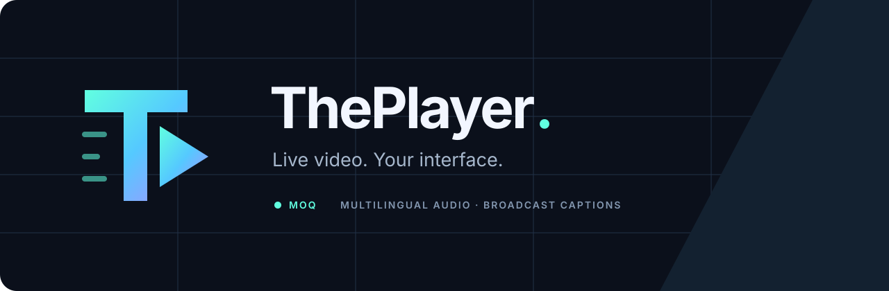

<p align="center">
  
</p>

<p align="center">
  <a href="https://github.com/XaMaB/ThePlayer/actions/workflows/check.yml"></a>
  
  
</p>

# ThePlayer

**Live television deserves a player that understands broadcast.**

ThePlayer is a modular browser player for live television and on-demand video. It combines MoQ delivery, original HLS and DASH engines, multilingual audio, broadcast captions and shared playback controls.

[**Try the live demo ↗**](https://demo.theplayer.dev)

[Protocols](#protocols) · [Codecs](#audio-and-video) · [Subtitles](#subtitles) · [HLS features](#hls-features) · [DASH](#dash) · [Quick start](#development) · [Integration](#library) · [Architecture](docs/architecture.md)

## What you get

- **MoQ live playback:** WebTransport delivery, cached startup and a four-second target reserve.
- **HLS live, VOD and EVENT playback:** TS/fMP4 segments, Auto ABR, manual quality selection and audio-only streams.
- **DASH live and VOD:** fMP4, quality/audio selection, text and broadcast captions, MPD Patch, ClearKey/Widevine and low-latency CMAF; see the verified playback scope below.
- **Multilingual audio and captions:** audio/CC menus, source-positioned broadcast captions and subtitle Off.
- **Adaptive Picture-in-Picture:** Document PiP with controls/captions where available, native video PiP fallback and configurable browser-driven Auto PiP. [Configuration and browser limits](docs/picture-in-picture.md).
- **Configurable controls and extras:** toolbar layouts, VOD speed, subtitle appearance, chapters, queue navigation, optional frame capture and native/Cast sender adapters. [Integrator guide and limitations](docs/controls-integration.md).
- **Buffering and seek feedback:** delayed flowing chevrons during buffering, configurable placement/colors/text, and directional skip-button waves with reduced-motion support. [Configuration](docs/controls-integration.md#buffering-indicator-and-seek-feedback).
- **Shared controls:** current Auto quality, resolution badges, play/pause, ±10 s seeking, configurable video scrubbing (`scrubbing: false` selects seek-on-release), keyboard shortcuts, adaptive fullscreen (including iPhone native-video fallback) and MediaInfo. LIVE appears only for live presentations.
- **Independent integration:** explicit source configuration, separate engine modules and no Origin/Relay dashboard dependency.

## Protocols

| Protocol                          | Status                    | Implemented scope                                                                                                  |
| --------------------------------- | ------------------------- | ------------------------------------------------------------------------------------------------------------------ |
| MoQ over WebTransport / WebSocket | Implemented               | moq-dev/moq, `moq-lite-06`, `origin-cmaf-v1` catalog/media profile; live playback                                  |
| HLS over HTTP(S)                  | Implemented               | Original engine; live, VOD and EVENT; MPEG-TS and fragmented MP4; Auto/manual quality                              |
| LL-HLS                            | Implemented fMP4 delivery | Partial-only startup, dependent parts, blocking reload, delta merge/fallback and bounded preload cache             |
| MPEG-DASH                         | Implemented               | fMP4 VOD/live, templates/Timeline/List/SIDX, quality and audio selection; [scope and limits](docs/dash-support.md) |
| UDP/RTP multicast                 | Origin input only         | The browser does not join multicast groups; use an Origin to ingest and publish media                              |

MoQ transport compatibility alone does not guarantee interoperability: the publisher and player must also agree on the catalog and media profile. HLS is a tested subset, not a claim of full support for every protocol version. See the [HLS support matrix](docs/hls-support.md).

## Audio and video

The player uses Media Source Extensions (MSE) and browser decoders. It does not transcode or bundle software video decoders.

| Codec / mode                   | HLS carriage                       | Status and limits                                                                                                                                                                                           |
| ------------------------------ | ---------------------------------- | ----------------------------------------------------------------------------------------------------------------------------------------------------------------------------------------------------------- |
| AVC / H.264                    | MPEG-TS and fMP4                   | Implemented; browser playback tested                                                                                                                                                                        |
| HEVC / H.265 Main and Main10   | MPEG-TS and fMP4 (`hvc1` / `hev1`) | Remux/configuration implemented and independently decoded with FFmpeg; browser/OS HEVC decoder required; HLS visual HEVC playback remains profile-specific; DASH Main playback is validated in Linux WebKit |
| AV1 Main, 8/10-bit             | fMP4 (`av01`)                      | Browser playback, quality changes and seeking tested; no AV1 TS/WebM/raw OBU input                                                                                                                          |
| AAC-LC / declared HE-AAC v1/v2 | MPEG-TS and fMP4                   | Implemented, including separate audio renditions; PS uses a mono core with stereo output                                                                                                                    |
| Audio-only AAC                 | MPEG-TS and fMP4                   | Implemented; bitrate selection and Video / Audio only mode for compatible mixed masters                                                                                                                     |
| AC-3 / E-AC-3 audio            | TS, packed audio and fMP4          | Implemented for the documented single-substream profiles; browser decoder required. Atmos is not certified                                                                                                  |
| Dolby Vision / HDR output      | —                                  | Dolby Vision and HDR display/tone mapping are not validated                                                                                                                                                 |

The codec table above describes HLS carriage. DASH has decoded-playback validation for AVC/AAC and AV1 in Chromium, Firefox and WebKit, and HEVC Main plus AC-3/E-AC-3 in Linux WebKit. Unsupported browser decoders are rejected explicitly. The MoQ engine appends catalog-advertised fragmented MP4 to MSE. Its codec compatibility depends on the publisher's media profile and the browser; the HLS-specific demux/remux matrix above does not imply equivalent MoQ codec validation. MoQ audio switching replaces the audio subscription/buffer while retaining the video connection and timeline.

MoQ targets a four-second buffer reserve; HLS has its own segment-based buffer and ABR policy. Actual buffer health varies with delivery and GOP structure. Neither target is a guaranteed end-to-end latency. MoQ adaptive bitrate rendition switching is not implemented.

## Subtitles

| Format                     | MoQ                                | HLS                                                       | Rendering / implemented scope                                                                                                     |
| -------------------------- | ---------------------------------- | --------------------------------------------------------- | --------------------------------------------------------------------------------------------------------------------------------- |
| DVB subtitles              | Implemented with compatible Origin | Not implemented                                           | Origin decodes timestamped bitmap cues; canvas preserves placement                                                                |
| Teletext                   | Implemented with compatible Origin | Not implemented                                           | Origin-decoded bitmap cues, selectable by advertised language/track                                                               |
| CEA-708 / DTVCC            | Implemented subset                 | Implemented SEI/CDP subset                                | Browser decoding from AVC SEI; service discovery, window anchors, alignment, explicit rows/columns and pen size                   |
| CEA-708 P16                | Implemented subset                 | Implemented                                               | Two-byte operands, Cyrillic/Latin Extended handling and configurable service encoding                                             |
| CEA-608                    | Not exposed                        | Implemented subset: fMP4 `c608` and AVC/HEVC SEI, CC1–CC4 | Original decoder; pop-on, paint-on, 2–4-row roll-up, PAC position/indent, character sets, foreground colors, italic and underline |
| WebVTT                     | Not exposed                        | Implemented subset                                        | External segmented WebVTT renditions, timestamp mapping and basic cue placement using browser TextTracks                          |
| TTML / IMSC1               | Not implemented                    | Implemented text subset                                   | fMP4 stpp, positioned/styled regions, timed spans, discrete style animations and ruby; see profile limits                         |
| WebVTT inside MP4 (`wvtt`) | Not implemented                    | Implemented subset                                        | fMP4 vttc/vtte samples, sample timing and cue settings                                                                            |

**CEA-608:** parity checks and duplicate-control suppression are implemented. Caption history supports seeking and quality transitions. Field-2 CC3/CC4 and TS/fMP4 SEI carriage are implemented; field-2 XDS packets are skipped. Background/foreground attributes are implemented, including translucent and transparent backgrounds. Firefox uses a feature-detected cell renderer when native cue-class styling is unavailable. Multiple `c608` tracks, flashing and Text/XDS services remain unsupported. Native browser typography means placement is not a pixel-exact broadcast rendering. A live join or seek with insufficient history can wait for the next complete caption update.

**CEA-708:** cues retain source window positions and synchronize to the media clock, including fullscreen letterboxing. P16 consumes both operands atomically: a zero high byte represents one character; other pairs use Unicode code-unit handling or a configured service encoding such as EUC-KR. Invalid surrogate values become replacement characters. HLS has its own original decoder with window/pen colors, print/scroll direction and media-time delays. Its snap display fallback and other limits are described in [HLS support](docs/hls-support.md). MoQ shares the same decoding core and preserves its canvas cue API; its rendering scope is described in [MoQ captions](docs/moq-captions.md).

**WebVTT:** scoped safe STYLE rules and cue/region placement are supported. Browsers without native VTTRegion use placement fallback; region scrolling/clipping is not emulated. DVB and teletext decoding belongs to the Origin; their availability here does not mean browser-side raw broadcast subtitle decoding.

DASH supports external WebVTT/TTML, fMP4 wvtt/stpp and clear video SEI CEA-608/708 through the shared text/caption renderers. Separate DASH c608/c708 tracks, encrypted text, raw DVB and teletext are not implemented; the MoQ Origin path remains separate.

The CC menu includes **Off**, language/service selection and DVB/TXT/CC badges. MediaInfo separates received events, including clears and refreshes, from displayed subtitles. See the [caption support details](docs/hls-support.md).

## DASH

DASH is implemented for browser fMP4/CMAF live and VOD. It includes quality/audio/view selection, text and CEA-608/708 captions, MPD Patch and XLink, hierarchical SIDX, tested ClearKey/Widevine DRM, low-latency chunk delivery, Content Steering, JPEG thumbnails and opt-in CMCD telemetry. LIVE appears only for dynamic presentations.

See the [support matrix and explicit limits](docs/dash-support.md), [integration and DRM examples](docs/dash-integration.md), [verification](docs/dash-validation.md) and [delivery plan](docs/dash-implementation-plan.md). Container, optional-profile and physical-device support remain specific to the documented matrix.

## HLS features

| Feature                              | Status                                                                                                                                           |
| ------------------------------------ | ------------------------------------------------------------------------------------------------------------------------------------------------ |
| Media and multivariant playlists     | Implemented; relative URLs and playlist variables                                                                                                |
| Live / VOD / EVENT                   | Implemented; sliding refresh, finite duration, seeking and EVENT-to-ended transitions                                                            |
| Auto ABR / manual quality            | Implemented for compatible renditions in the same audio/subtitle groups                                                                          |
| Multilingual external audio          | AAC renditions with independent buffers and selection                                                                                            |
| DEFAULT / AUTOSELECT / FORCED        | Used for supported rendition selection; explicit choices and subtitle Off take priority                                                          |
| Network loading                      | Fetch or XHR; abort, timeout, bounded recovery window and byte ranges                                                                            |
| AES-128 encryption                   | Identity keys, explicit/sequence IV, independent map keys and rotation                                                                           |
| Discontinuities                      | Timestamp rebasing; arbitrary timeline repair is not supported                                                                                   |
| AES-256-GCM                          | Whole-resource authenticated encryption; embedded IV/tag, including maps                                                                         |
| Session keys                         | Bounded identity-key preload, consumed by media/map decryption                                                                                   |
| SAMPLE-AES TS                        | AVC/AAC/AC-3/E-AC-3 identity keys; rotation and explicit/sequence IV, byte-exact and browser tests                                               |
| DRM / EME                            | CENC/CBCS fMP4; ClearKey and public Widevine CBCS playback tested; manifest PSSH and bounded key rotation                                        |
| Content steering / interstitials     | Steering with changing quality/language inventories; interstitial playback, preloads, markers and asset controls implemented; see profile limits |
| Timed metadata                       | ID3 from TS/packed AAC; emsg v0/v1 and CMAF ID3, with presentation-time event data                                                               |
| I-frame trick play / image playlists | JPEG image/tile and coded I-frame seek previews implemented; continuous trick-play pending                                                       |
| Packed audio                         | ADTS AAC and MP3 with ID3 anchors, rollover and AES-128; AAC/AC-3/E-AC-3 SAMPLE-AES; single independent E-AC-3 substream                         |
| Declared GAP segments                | Skipped without requests; playback resumes at buffered media after the declared interval                                                         |
| Live timeline resets                 | Bounded coordinated media restart; paused state and track selection retained                                                                     |

See [architecture](docs/architecture.md), [research](docs/hls-research.md) and [detailed limits](docs/hls-support.md).

## Development

Requires Node.js 24+, npm and Git. Playback requires MediaSource or ManagedMediaSource and suitable browser codecs. On iPhone the player uses ManagedMediaSource and disables remote playback while attached (no AirPlay alternative is provided). MoQ requires a secure context and WebTransport or a compatible WebSocket relay; HLS and DASH require HTTP(S) access and suitable CORS headers.

```sh
git clone https://github.com/XaMaB/ThePlayer.git
cd ThePlayer
```

```sh
npm ci
npm run bootstrap
npm run build
npm start
```

Open `http://localhost:5173`. For HLS or DASH, select the protocol and supply an M3U8 or MPD URL. For MoQ, supply a relay URL, namespace and, for a self-signed development relay, its certificate fingerprint for WebTransport. WebSocket fallback requires a browser-trusted TLS certificate; a WebTransport fingerprint cannot authorize WSS. WebTransport requires a secure context: localhost or HTTPS. The demo has no dependency on the Origin or Relay administration applications.

The bootstrap checks out moq-dev at `caf6ebc05d0b56a5689af1df431dd13804aaa1a2` into `.cache/moq`. Builds verify this revision. `MOQ_SOURCE` may point to an existing checkout at that revision. Do not replace it with an arbitrary npm version: the protocol and JS API are version sensitive.

```sh
npm test
npm run typecheck
npm run format
npm run check
```

The package remains private to prevent accidental npm publication. This does not prevent publishing its source repository.

## HLS integration

Choose **HLS** in the demo and enter a playlist URL. The engine is our own implementation, with no hls.js, Video.js/VHS or Shaka runtime dependency. See [architecture research](docs/hls-research.md) and [tested coverage](docs/hls-support.md).

```js
const player = new ThePlayer(video);
await player.load({
  protocol: 'hls',
  url: 'https://media.example.com/master.m3u8',
});
```

Deploy the entire `dist` directory, including `chunks`; HLS and DASH are loaded on demand. Bundles are generated by `npm run build` and are not checked into GitHub. See [DASH integration](docs/dash-integration.md) for MPD and DRM examples. LIVE appears only for live presentations; VOD has a seek bar and duration.

## HLS / DASH Auto quality policy

Startup and upgrade behavior are independent source options. They apply to Auto quality within the browser-compatible ladder:

```js
await player.load({
  protocol: 'hls', // or 'dash'
  url: manifestUrl,
  quality: 'auto',
  abr: { startup: 'highest', upswitch: 'direct' },
});
```

| Policy                                                           | Configuration                                 |
| ---------------------------------------------------------------- | --------------------------------------------- |
| Start high, then adapt to measured bandwidth                     | `{ startup: 'highest', upswitch: 'direct' }`  |
| Start low, then jump directly to the highest sustainable profile | `{ startup: 'lowest', upswitch: 'direct' }`   |
| Start low and climb one profile at a time (default)              | `{ startup: 'lowest', upswitch: 'stepwise' }` |

`direct` skips intermediate upgrades, but retains the 25% bandwidth reserve, at least two throughput samples, buffer headroom, upgrade cooldown and failed-profile quarantine. It does not promise the absolute highest profile or a jump on the second segment. Downgrades do not wait for the upgrade cooldown. Starting high can increase startup delay on an unknown/slow connection. Explicit numeric `quality` selects manual mode and takes precedence over `abr.startup`; returning to Auto retains the current quality and estimator rather than restarting the startup policy. Options are read on load; reload the source to change them. MoQ rendition ABR is separate and is not added by these options.

The demo exposes **Auto start quality** and **Auto quality increases**; select them before **Connect**. Embed/demo query parameters `abrStartup=highest` and `abrUpswitch=direct` also configure them. Generated integration snippets include the chosen policy. `diagnostics.quality.abr` reports the resolved options.

## Library

MoQ uses WebTransport when permitted by moq-dev and can fall back to QMux over WebSocket on a compatible relay. Set `websocket: false` to disable fallback, or `websocketUrl` to select a separate endpoint. The pinned moq-dev version excludes WebKit WebTransport because of an upstream long-session issue; iPhone therefore needs the WebSocket relay endpoint. This fallback uses TCP and has different loss/latency behavior from QUIC.

For local WSS testing, the device must trust the relay certificate. Accepting a warning for the demo page does not necessarily authorize a separate relay connection. Production should use a browser-trusted certificate and hostname. `certificateHash` only applies to WebTransport.

```js
import { ThePlayer, SubtitleRenderer } from './dist/player.js';

const player = new ThePlayer(video);
const subtitles = new SubtitleRenderer(video, canvas);
subtitles.attach(player);

await player.load({
  protocol: 'moq',
  relayUrl: 'https://relay.example.com:4434',
  namespace: 'live/channel-one',
  catalogTrack: 'catalog',
});

await player.selectAudioTrack('audio-track-name');
player.selectSubtitleTrack('subtitle-track-name');
player.selectSubtitleTrack(''); // Off

// When removing the player:
subtitles.destroy();
await player.destroy();
```

The application provides the video and overlay canvas; position the canvas absolutely over the video with `pointer-events: none`. Track names come from `audioTracks` and `subtitleTracks`, not display labels. Listen for `catalog` and `subtitletracks` to populate menus. Subtitle rendering is optional; the video engine does not require a canvas.

The optional shared controls accept a configurable inactivity timeout:

```js
import { mountControls } from './dist/player.js';
const controls = mountControls(container, video, () => player, console.error, {
  autoHideDelayMs: 1500, // Default; 5000 = five seconds, 0 = always visible
});
// Later: controls.destroy();
```

`container` wraps the video and uses the shared control styles (`demo/style.css`, copied to `dist/style.css`). The delay is in milliseconds and must be finite and nonnegative (at most 2147483647). Interaction restarts the timer; paused playback, active touches, open menus and focused controls keep it visible. A touch on the video reveals controls; use the play/pause buttons to toggle playback.

`new ThePlayer(video, source)` followed by `init()` is also supported. `MoqPlayer` remains a legacy low-level alias for `MoqEngine`; new integrations should use `ThePlayer`.

## Modules

- `src/core`: common source lifecycle, engine registry and public engine contract; no MoQ imports.
- `src/engines/moq`: WebTransport connection, catalog, subscriptions, MSE, audio switching and buffering.
- `src/engines/hls`: HLS scheduling, shared HTTP/MP4/EME primitives, TS/fMP4 processing, ABR and text/CEA-608/708 renderers.
- `src/engines/dash`: MPD/Patch/XLink, addressing, Period/live recovery, CMAF, steering, telemetry, thumbnails and DASH captions.
- `src/subtitles`: cue history/counters, reusable canvas renderer and CEA-708 decoding/layout.
- `src/ui`: the current in-video controls. These still use the demo's documented DOM IDs; this is not yet a drop-in custom element.
- `demo`: source form, optional channel directory, embed page and styling.
- `scripts`: reproducible build and pinned upstream checkout.
- `tests`: unit and engine lifecycle tests, without live multicast requirements.

See [architecture](docs/architecture.md) for extension boundaries and events.

## Optional deployment configuration

`settings.json` is local and ignored by Git. The server defaults to localhost HTTP port 5173 when it is absent. For HTTPS deployment, configure `webHost`, `webPort`, `cert` and `key`. An optional `relayDirectoryUrl` and `relayTrustPem` enable the demo channel list. `MOQ_PLAYER_CONFIG` selects another configuration file.

`/embed.html?relay=...&namespace=...&hash=...` loads without directory polling. `/player.js` is the default library bundle; `/core.js` is the transport-independent core.

To prepare a clean source directory for a new repository:

```sh
npm run export -- /path/to/ThePlayer
```

The destination must not exist. This copies an explicit source/documentation allowlist and includes the CI workflow. It does not publish or create a remote repository.

Do not commit local configuration, TLS keys, `.cache`, `node_modules`, generated bundles, private/captured recordings or operational channel lists. Redistributable synthetic test fixtures must include their generator and provenance. Build artifacts are generated from source.

## Contributing

Start with [the architecture](docs/architecture.md). Keep transport-specific buffering inside the engine, caption rendering inside the subtitle module, and directory discovery inside the demo. Run `npm run check` before opening a pull request.

For playback bugs, include browser/version, codec and catalog details, reproduction steps and relevant MediaInfo values. For caption bugs, include the subtitle format, service/language and a small redistributable fixture where possible. Remove credentials and private endpoint details from reports.

## Roadmap

- Extend optional HLS media/text profiles, codec/device interoperability and continuous validation.
- Extend HLS caption attribute and typography coverage.
- Complete the DASH interoperability and device acceptance matrix.
- Normalize track/diagnostic models across engines.
- Package the controls as a self-contained UI component.
- Extend caption conformance and fixture coverage.

## License

Google Cast optionally loads Google’s Web Sender SDK only after explicit application/demo opt-in; it is not bundled with the player.

Application code is Apache-2.0. See `NOTICE`, `LICENSE-APACHE` and the included upstream notices for bundled dependencies.

### Playback shortcuts

Space or K toggles play/pause; Left/Right seeks by ten seconds within the available timeline. The center controls offer the same actions. Live streams can seek only within their available DVR/buffer window. Shortcuts apply to the active player and leave text fields and menu selection keys alone. Unavailable audio/CC controls use an ordinary cursor, not a loading indicator.

### Demo DRM configuration

In the HLS or MPEG-DASH source form, expand **DRM · License configuration**. Choose a key system and enter the license server URL. Optional settings include JSON request headers, cookie credentials, license timeout (1–120000 ms), a base64-encoded binary server certificate, and video/audio robustness strings. Clear Key also accepts a JSON mapping of 32-digit hexadecimal key IDs to 32-digit hexadecimal keys; local keys take precedence over the license URL. Choose **None / unencrypted** to disable DRM on the next connection.

The demo posts the raw EME challenge and reads the binary license response. License endpoints must permit browser CORS requests, including preflights for custom headers. This is a generic EME adapter: selecting Widevine, PlayReady or FairPlay does not guarantee browser/CDM/provider compatibility. Providers requiring JSON/XML envelopes, response extraction, FairPlay content-ID transformations or legacy Safari APIs need an application-specific `drm.license` integration and, where applicable, additional engine support. See [DASH DRM integration](docs/dash-integration.md).

DRM settings apply on **Connect** and remain in page memory. They are not stored in browser storage or added to share URLs. The integration example omits license URLs, headers, certificates and keys, and includes placeholders for application-owned values. The license callback forwards the engine's abort signal and uses its configured timeout. License requests use Fetch even when media transport is set to XMLHttpRequest.
