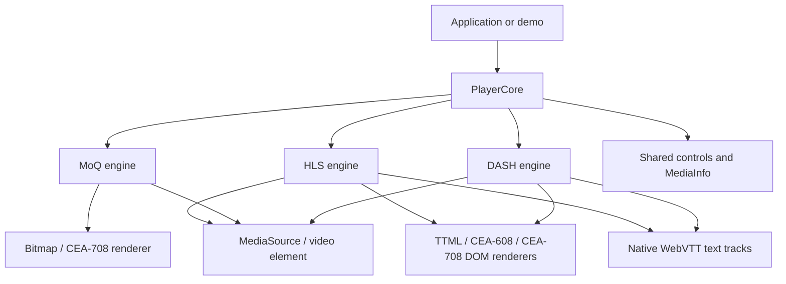

# Architecture

The application supplies a source to `PlayerCore`. Its engine registry maps a protocol name to a factory. The core releases the previous engine before initializing a replacement, forwards events, and destroys subscriptions through the engine lifecycle. Only one engine owns the video element and media source at a time. `core/media-source.ts` selects ordinary MediaSource when available, otherwise ManagedMediaSource, and shares this choice with codec probes and restart paths. Managed attachment disables remote playback because no AirPlay alternative is supplied; teardown restores the prior setting.

`ThePlayer` registers MoQ and lazily imported original HLS and DASH engines. Import the separate `core.js` bundle to avoid the MoQ dependency entirely when supplying other engines. Unknown protocols fail explicitly, without stopping a currently loaded source. A supported source replacement releases the old engine before loading the new one; a failed load therefore does not retain the previous stream.

## Engine contract

The `PlaybackEngine` TypeScript interface in `src/core/player.ts` defines initialization, teardown, playback, track selection and observable state. Engines own transport-specific retries, buffering and media ingestion. The contract is an initial extension API: some catalog/diagnostic payloads retain a MoQ-compatible shape. New engines must adapt to the shared controls rather than expose an unrelated track model.

## Module boundaries

| Module               | Responsibility                                                                   |
| -------------------- | -------------------------------------------------------------------------------- |
| `src/core/player.ts` | Engine registry, serialized source replacement, event forwarding and teardown    |
| `src/player.ts`      | Default MoQ registration and lazy HLS/DASH registration                          |
| `src/engines/moq/`   | moq-dev transport integration, media ingestion and group-based buffering         |
| `src/engines/hls/`   | Original playlist parser, segment scheduling, ABR, demux/remux and HLS captions  |
| `src/engines/dash/`  | MPD/Patch/XLink, indexes, live recovery, fMP4/CMAF, steering, text and telemetry |
| `src/subtitles/`     | MoQ bitmap/CEA-708 caption rendering and shared caption metrics                  |
| `src/ui/controls.ts` | Playback, quality/audio/CC menus, keyboard controls and MediaInfo                |
| `demo/`              | Source selection, directory discovery and integration examples                   |

## Events

Events forwarded by the core:

| Event             | Detail                                           |
| ----------------- | ------------------------------------------------ |
| `statechange`     | State string                                     |
| `streamchange`    | Live presentation state                          |
| `qualitylevels`   | Available quality levels                         |
| `qualitychange`   | Current engine quality selection/state           |
| `subtitlemetrics` | Caption reception/display counters               |
| `catalog`         | Media catalog                                    |
| `error`           | Error object                                     |
| `autoplayblocked` | No payload                                       |
| `audiochange`     | Selected audio track                             |
| `subtitletracks`  | Available subtitle tracks                        |
| `subtitlechange`  | Selected track, or null for Off                  |
| `caption`         | `{ track, cue }` for the selected subtitle track |
| `captionwarning`  | Recoverable caption error                        |

Additional engine-specific events forwarded by the core include `metadata`, `metadatawarning`, `videochange`, `videotracks`, `pathwaychange`, the `daterange*` family and the `interstitial*` family. Metadata carries presentation timestamps; it is an availability/append notification, not a playback-time callback. HLS extension events do not imply equivalent DASH extension support.

MoQ bitmap and CEA-708 cues share the media timestamp domain. `SubtitleRenderer` consumes caption events and owns canvas drawing, bitmap decoding and displayed-cue counters. Selection invalidates pending bitmap decodes. Destroying or reattaching the renderer clears listeners and its animation loop.

## HLS media and caption pipeline

`engine.ts` schedules playlist refreshes and segment appends. `playlist.ts` parses manifests; `selection.ts` handles rendition preferences; `abr.ts` estimates bandwidth and selects compatible qualities. `network.ts` owns Fetch/XHR, timeouts and bounded retries. Each `MediaLane` manages the initialization, timing and SourceBuffer for its main or external-audio rendition.

MPEG-TS samples pass through the original AVC/HEVC/AAC/AC-3/E-AC-3 demux/remux path. fMP4 initialization is inspected for supported video/audio configuration before MSE appends. Browser decoders perform the actual audio/video decoding. Quality transitions fill the previous rendition through the switching boundary; the engine's buffering policy is separate from MoQ's GOP/group policy.

External WebVTT uses the subtitle rendition loader. For fMP4 CEA-608, `c608-mp4.ts` extracts timestamped `cdat` pairs, `cea608.ts` decodes channel memories/commands, and `cea608-timeline.ts` checkpoints history for seeking and quality changes. The engine maps rows and columns to native text cues. Caption descriptors are excluded from MSE without moving A/V payload offsets. `c708-mp4.ts` reads CDP from separate c708/ccdp tracks. `cea-sei.ts` also extracts ATSC caption data from clear AVC/HEVC SEI. Original CEA-708 packet, service, timeline and renderer modules decode and render services with media-clock window geometry and P16 handling.

HLS WebVTT uses browser TextTracks. CEA-608 uses native cue-class styling where supported and a feature-detected 32-column DOM compositor otherwise; hidden TextTracks retain timing metadata in that fallback. TTML and CEA-708 use their own DOM renderers; MoQ bitmap/CEA-708 captions use `SubtitleRenderer`. They share selection and metric conventions but have different rendering paths. See the [HLS support matrix](hls-support.md) for exact carriage, codec and caption limitations.

Packed AAC, MP3, AC-3 and E-AC-3 have independent framing modules and share ID3 clock recovery. TS timed ID3 and fMP4 emsg are exposed through `metadata` events. These are append-time notifications carrying presentation timestamps; applications decide when and how to display or act on them. Malformed optional tags emit `metadatawarning`.

## HLS protection

Whole-resource AES-128 and AES-256-GCM decryption happens before demux/inspection. TS SAMPLE-AES decrypts AVC/AAC elementary samples before transmuxing. fMP4 cenc/cbcs stays encrypted through SourceBuffer append; the browser CDM performs decryption through `eme.ts`. Identity playlist keys use ClearKey automatically; explicit DRM configurations provide keys or an application-owned license callback. MediaSource and temporary key sessions share one engine lifetime, with bounded license requests and teardown cancellation. ClearKey tests do not certify commercial CDMs.

## DASH media pipeline

`src/engines/dash/mpd.ts` parses namespaced MPDs and inherited addressing. `segments.ts` produces bounded segment windows using integer media clocks; `sidx.ts` resolves flat byte-range indexes. `engine.ts` owns MPD refresh, Period selection, MSE lanes, quality/audio switching and teardown. It reuses ThePlayer HTTP, MP4 inspection, throughput estimation and EME primitives; HLS manifest/scheduling logic remains separate.

DASH release scope is tracked in [DASH support](dash-support.md) with verified scope and remaining extension, resilience and device work. DASH text loading runs independently of A/V and follows the playback Period rather than a prefetched Period. Clear video SEI captions use the original CEA-608/708 timelines and DOM renderers, retaining service selection, placement and P16 configuration. CMAF chunk assembly validates complete moof/mdat units before appending; A/V lanes download concurrently. MPD Patch applies to an isolated XML document before parser validation and full-MPD fallback.

## Extending engines

Implement a separate engine, then register its factory with `PlayerCore` or the third constructor argument to `ThePlayer`. Keep manifest/network libraries inside that engine. Prefer optional entry points or dynamic imports so MoQ-only users do not download HLS/DASH dependencies.

Before exposing the engine, normalize its audio/subtitle tracks and diagnostics, connect caption rendering and metrics to the common selection lifecycle, and test source replacement and teardown. Its buffer/ABR policy must be independent of MoQ's group-cache policy. The selected HLS direction is our own implementation, not a Shaka/hls.js/VHS adapter. See the HLS research and support documents.

## Demo boundary

Directory discovery, reconnecting to a changed channel namespace, source inputs and integration examples belong to the demo. Library playback requires only an explicit source, with no administration API calls. The present controls retain a DOM contract with the demo; extracting a fully self-contained UI component is a separate step.

Content steering is isolated in `src/engines/hls/steering.ts`: it validates manifests and clones and owns pathway priorities/penalties. The engine applies selections through the same rendition-switching pipeline used by quality/audio changes. Speculative LL-HLS bytes remain isolated in `preload.ts` until authoritative playlist references allow their use.

## HLS optional presentation modules

`interstitials.ts` resolves asset lists and timing rules. `interstitial-session.ts` owns the inserted VOD presentation; the outer engine pauses its primary scheduler and restores the primary playlist, decoder and timeline when insertion ends. Both never append to the shared video element simultaneously. Interstitial events remain separate from ordinary timed metadata.

`thumbnails.ts` owns JPEG image-playlist previews. `iframe-thumbnails.ts` prepares independent coded pictures through `MediaLane`, and `preview-frame.ts` decodes them with a temporary WebCodecs decoder. Both expose the protocol-neutral `getThumbnail()` result, hold bounded object-URL caches and release resources on destruction. Preview failure is isolated from primary playback.

`ttml.ts` resolves XML timing and styles. `ttml-animation.ts` compiles discrete changes into bounded time intervals, preserving inherited style resolution during seeking. `ttml-renderer.ts` owns the overlay; `ttml-ruby.ts` maps paired ruby bases/annotations to browser layout. No subtitle markup is injected as HTML.

`playlist-reload.ts` owns normal/blocking/delta updates and initial CDN freshness checks. `cdn-tune-in.ts` computes newer segment/part targets from HTTP Age and actual playlist progress. The network client retains response metadata consistently across Fetch and XHR. Initial preload hints are activated only after tune-in selects a usable playlist.

`dash/network.ts` retries only MPD-declared BaseURL alternatives, temporarily penalizes failed locations and recomputes headers for each destination. It does not replay a partially appended CMAF response from a mirror in the same assembler. Clock/timing or track-topology resets replace MediaSource through a bounded restart path; independent Origin/Relay services are unaffected.

DASH `EventStream` and `emsg` dispatch bounded, deduplicated `metadata` payloads without interpreting scripts. MPD `ProducerReferenceTime` maps the media clock to the producer clock for diagnostics and opt-in latency control. MPD/metadata inspection is not full support for every optional DASH extension. See [integration](dash-integration.md), [test coverage](dash-validation.md) and the explicit [support limits](dash-support.md).

DASH remote-element resolution lives in `xlink.ts`; `sidx.ts` resolves bounded index trees. `network.ts` adds manifest validators and mirror selection to the shared HTTP client, while `steering.ts` applies service-location policy. `producer-time.ts` and `chunk-throughput.ts` distinguish production clocks from transfer timing. `thumbnails.ts`, `telemetry.ts` and `qoe.ts` keep image lookup, CMCD serialization and local playback measurements separate from media scheduling. The core forwards `periodchange` and `qoe` alongside the existing track/metadata events. Telemetry has no automatic collection endpoint.

## Optional controls modules

`src/ui/control-layout.ts` owns toolbar/center presentation; `control-extras.ts` mounts grouped settings in the existing options menu. `caption-appearance.ts` scopes preferences to a video, `playback-queue.ts` owns application-supplied sources and chapters, and `frame-capture.ts` handles local PNG export. `remote-playback.ts` adapts native target discovery and an explicitly loaded Google Cast SDK. These modules do not replace transport engines or provide a DRM receiver. Integrators own queue lifetime, remote URLs and SDK/receiver configuration. See [Controls integration](controls-integration.md) for defaults, examples and acceptance boundaries.
