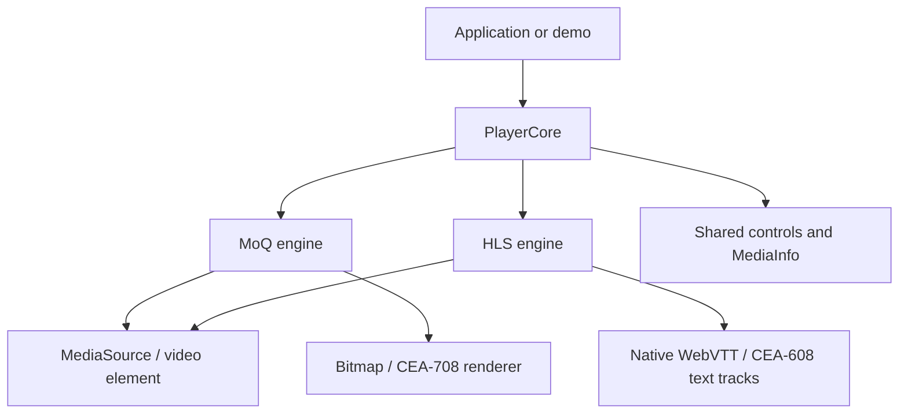

# Architecture

The application supplies a source to `PlayerCore`. Its engine registry maps a protocol name to a factory. The core releases the previous engine before initializing a replacement, forwards events, and destroys subscriptions through the engine lifecycle. Only one engine owns the video element and MediaSource at a time.

`ThePlayer` registers MoQ and a lazily imported original HLS baseline engine. Import the separate `core.js` bundle to avoid the MoQ dependency entirely when supplying other engines. Unknown protocols fail explicitly, without stopping a currently loaded source.

## Engine contract

The `PlaybackEngine` TypeScript interface in `src/core/player.ts` defines initialization, teardown, playback, track selection and observable state. Engines own transport-specific retries, buffering and media ingestion. The contract is an initial extension API: some catalog/diagnostic payloads retain a MoQ-compatible shape. New engines must adapt to the shared controls rather than expose an unrelated track model.

## Module boundaries

| Module               | Responsibility                                                                  |
| -------------------- | ------------------------------------------------------------------------------- |
| `src/core/player.ts` | Engine registry, serialized source replacement, event forwarding and teardown   |
| `src/player.ts`      | Default MoQ registration and lazy HLS registration                              |
| `src/engines/moq/`   | moq-dev transport integration, media ingestion and group-based buffering        |
| `src/engines/hls/`   | Original playlist parser, segment scheduling, ABR, demux/remux and HLS captions |
| `src/subtitles/`     | MoQ bitmap/CEA-708 caption rendering and shared caption metrics                 |
| `src/ui/controls.ts` | Playback, quality/audio/CC menus, keyboard controls and MediaInfo               |
| `demo/`              | Source selection, directory discovery and integration examples                  |

## Events

Events forwarded by the core:

| Event             | Detail                                           |
| ----------------- | ------------------------------------------------ |
| `statechange`     | State string                                     |
| `streamchange`    | Live presentation state                          |
| `qualitylevels`   | Available quality levels                         |
| `qualitychange`   | Current engine quality selection/state           |
| `subtitlemetrics` | Caption reception/display counters               |
| `catalog`         | Media catalog                                    |
| `error`           | Error object                                     |
| `autoplayblocked` | No payload                                       |
| `audiochange`     | Selected audio track                             |
| `subtitletracks`  | Available subtitle tracks                        |
| `subtitlechange`  | Selected track, or null for Off                  |
| `caption`         | `{ track, cue }` for the selected subtitle track |
| `captionwarning`  | Recoverable caption error                        |

Bitmap and CEA-708 cues share the media timestamp domain. `SubtitleRenderer` consumes caption events and owns canvas drawing, bitmap decoding and displayed-cue counters. Selection invalidates pending bitmap decodes. Destroying or reattaching the renderer clears listeners and its animation loop.

## HLS media and caption pipeline

`engine.ts` schedules playlist refreshes and segment appends. `playlist.ts` parses manifests; `selection.ts` handles rendition preferences; `abr.ts` estimates bandwidth and selects compatible qualities. `network.ts` owns Fetch/XHR, timeouts and bounded retries. Each `MediaLane` manages the initialization, timing and SourceBuffer for its main or external-audio rendition.

MPEG-TS samples pass through the original AVC/HEVC/AAC demux/remux path. fMP4 initialization is inspected for AVC, HEVC, AV1 and AAC configuration before MSE appends. Browser decoders perform the actual audio/video decoding. Quality transitions fill the previous rendition through the switching boundary; the engine's buffering policy is separate from MoQ's GOP/group policy.

External WebVTT uses the subtitle rendition loader. For fMP4 CEA-608, `c608-mp4.ts` extracts timestamped `cdat` pairs, `cea608.ts` decodes channel memories/commands, and `cea608-timeline.ts` checkpoints history for seeking and quality changes. The engine maps rows and columns to native text cues. Caption descriptors are excluded from MSE without moving A/V payload offsets. `c708-mp4.ts` reads CDP from separate c708/ccdp tracks. `cea-sei.ts` also extracts ATSC caption data from clear AVC/HEVC SEI. Original CEA-708 packet, service, timeline and renderer modules decode and render services with media-clock window geometry and P16 handling.

HLS WebVTT/CEA-608 uses browser TextTracks; TTML and CEA-708 use their own DOM renderers; MoQ bitmap/CEA-708 captions use `SubtitleRenderer`. They share selection and metric conventions but have different rendering paths. See the [HLS support matrix](hls-support.md) for exact carriage, codec and caption limitations.

Packed audio uses the same AAC transmuxer after `id3.ts`/`packed-audio.ts` recover its clock anchor. TS timed ID3 and fMP4 emsg are exposed through `metadata` events. These are append-time notifications carrying presentation timestamps; applications decide when and how to display or act on them. Malformed optional tags emit `metadatawarning`.

## HLS protection

Whole-resource AES-128 and AES-256-GCM decryption happens before demux/inspection. TS SAMPLE-AES decrypts AVC/AAC elementary samples before transmuxing. fMP4 cenc/cbcs stays encrypted through SourceBuffer append; the browser CDM performs decryption through `eme.ts`. Identity playlist keys use ClearKey automatically; explicit DRM configurations provide keys or an application-owned license callback. MediaSource and temporary key sessions share one engine lifetime, with bounded license requests and teardown cancellation. ClearKey tests do not certify commercial CDMs.

## Extending HLS or adding DASH

Implement a separate engine, then register its factory with `PlayerCore` or the third constructor argument to `ThePlayer`. Keep manifest/network libraries inside that engine. Prefer optional entry points or dynamic imports so MoQ-only users do not download HLS/DASH dependencies.

Before exposing the engine, normalize its audio/subtitle tracks and diagnostics, connect caption rendering and metrics to the common selection lifecycle, and test source replacement and teardown. Its buffer/ABR policy must be independent of MoQ's group-cache policy. The selected HLS direction is our own implementation, not a Shaka/hls.js/VHS adapter. See the HLS research and support documents.

## Demo boundary

Directory discovery, reconnecting to a changed channel namespace, source inputs and integration examples belong to the demo. Library playback requires only an explicit source, with no administration API calls. The present controls retain a DOM contract with the demo; extracting a fully self-contained UI component is a separate step.

Content steering is isolated in `src/engines/hls/steering.ts`: it validates manifests and clones and owns pathway priorities/penalties. The engine applies selections through the same rendition-switching pipeline used by quality/audio changes. Speculative LL-HLS bytes remain isolated in `preload.ts` until authoritative playlist references allow their use.
