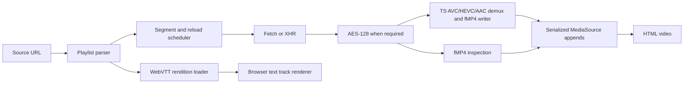

# HLS architecture research and implementation boundaries

Reviewed 2026-11-17. The HLS engine in `src/engines/hls` is original application code. It does not import, vendor or wrap hls.js, Video.js/VHS, Shaka, or mux.js. The existing MoQ engine and its caption decoder retain their previously documented dependencies; this is not a claim that the entire repository has no third-party code.

## What we learned

| Project        | Architectural lesson                                                                                                                                       | Application in ThePlayer                                                                                                                                 |
| -------------- | ---------------------------------------------------------------------------------------------------------------------------------------------------------- | -------------------------------------------------------------------------------------------------------------------------------------------------------- |
| hls.js         | Separate playlist scheduling, fragment loading, media appends and adaptation; treat audio and subtitles as independent pipelines.                          | Small parser/network/media modules, cancellable requests and one serialized MediaSource owner. ABR and alternate-rendition scheduling remain later work. |
| Video.js + VHS | Video.js is the player/UI layer; VHS handles streaming. Playlist state and segment loading are distinct, with an append queue between downloading and MSE. | Keep transport out of the shared controls. Source switching belongs to core; the HLS engine owns segment scheduling.                                     |
| Shaka Player   | Manifest interpretation, networking, stream scheduling, presentation time and media appends have separate responsibilities.                                | Preserve an engine boundary suitable for a future DASH module, rather than embedding HLS-specific behavior throughout the UI.                            |

These are architectural concepts, not translated or renamed implementations. Documentation was used for comparison; the baseline parser, TS demux/transmux, ISO BMFF writer and request client were written for ThePlayer against the relevant formats.

Primary references:

- [hls.js design](https://github.com/video-dev/hls.js/blob/master/docs/design.md)
- [VHS glossary](https://github.com/videojs/http-streaming/blob/main/docs/glossary.md)
- [VHS walkthrough](https://github.com/videojs/http-streaming/blob/main/docs/a-walk-through-vhs.md)
- [Shaka architecture](https://shaka-project.github.io/shaka-player/docs/api/tutorial-architecture.html)
- [Shaka StreamingEngine API](https://shaka-project.github.io/shaka-player-release/docs/api/shaka.media.StreamingEngine.html)
- [RFC 8216](https://www.rfc-editor.org/rfc/rfc8216)
- [HLS second edition, draft 22](https://datatracker.ietf.org/doc/html/draft-pantos-hls-rfc8216bis-22)
- [Apple's 2026 HLS updates](https://developer.apple.com/streaming/Whats-new-HLS.pdf)

## Data flow

## Staged implementation

The baseline is a working vertical slice, not a replacement for mature engines on arbitrary streams. See [the support matrix](hls-support.md) before integration.

Next stages: timestamp/PSI edge cases and external audio; quality selection and ABR; LL-HLS part scheduling with blocking and delta updates; IMSC1/TTML carriage and rendering; broader codecs, EME/DRM, steering and interstitials. Each requires deterministic fixtures and browser checks before it is advertised as supported. Reading a tag does not implement the feature it signals.

HEVC configuration references: the [W3C HEVC codec registration](https://www.w3.org/TR/webcodecs-hevc-codec-registration/) identifies `hvc1`/`hev1` codec strings and the ISO/IEC 14496-15 HEVCDecoderConfigurationRecord. Our TS path parses HEVC parameter sets and builds that record; it does not import another player's HEVC parser. Browser support is checked with MSE against the advertised and actual codec configurations. Independent FFmpeg decoding validates the generated samples separately from browser availability.

AV1 container and codec signaling follow [AOM AV1 ISOBMFF v1.3.0](https://aomediacodec.github.io/av1-isobmff/v1.3.0.html), sections 2.2–2.4 and 5. `av1.ts` is an original parser for the decoder-record fields and codec metadata; fMP4 initialization/sample data are passed through to MSE. Existing browser decoders interpret OBUs. The Apple 10-bit AV1 example and generated libaom fixtures exercise the integration without adding another player's runtime or source.

CEA-608 is implemented independently from the [CTA-608-E standard text](https://decode-orc.github.io/analogue-video-specifications/video_metadata/ANSI-CTA-608-E-S-2019/ANSI-CTA-608-E-S-2019/) and Apple's [closed-caption sample description](https://developer.apple.com/documentation/quicktime-file-format/closed_captioning_sample_description) and [sample-data timing rules](https://developer.apple.com/documentation/quicktime-file-format/closed_captioning_sample_data/sample_data). The pipeline extracts caption samples before neutralizing their MSE descriptors, decodes channel memories and commands, then emits positioned native text cues. No caption implementation from hls.js, Shaka or VHS is imported or copied. Supported commands and deliberate limitations are listed in the support matrix.
